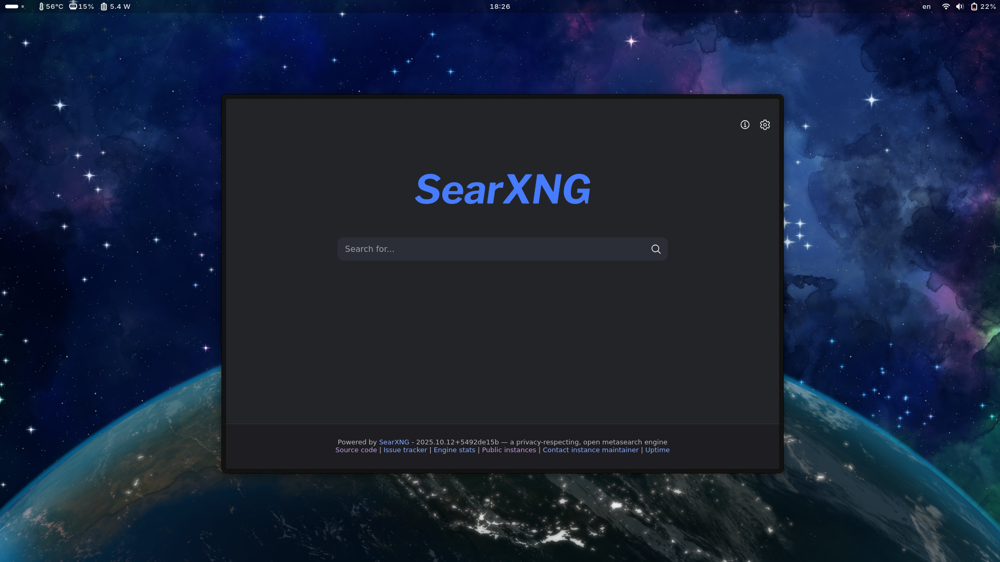
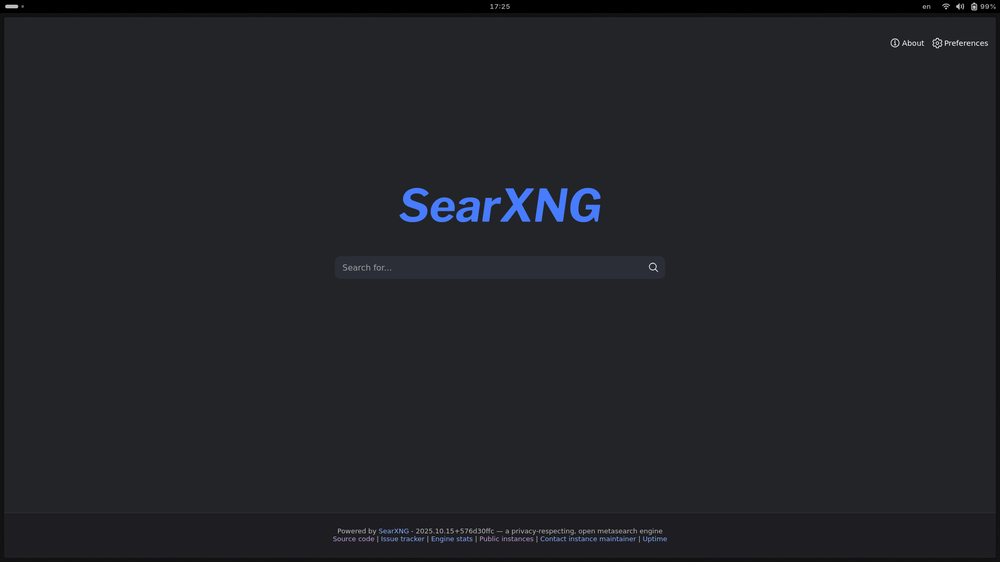
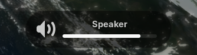

# Compact Top Bar

Compact Top Bar is a GNOME Shell extension that reduces the top panel's height and adapts its background transparency to the windows on the panel's monitor. It also styles GNOME's on-screen display (OSD).

## Compatibility and dependencies

- GNOME Shell 46, 47, 48, 49, 50, and 51 are listed as supported.
- Fedora 45's GNOME Shell 51.1 is the target for the Shell 51 compatibility update.
- The extension runs in GNOME Shell using GJS. Its preferences use GTK 4 and libadwaita, which are provided by the GNOME desktop.
- No other GNOME extension is required.

The GNOME Extensions website is a separate distribution and is not updated by GitHub commits.

## Features

- Makes the panel 25 pixels high, uses a 10-point font, and reduces panel-button horizontal padding.
- Uses a mostly transparent black panel background when no eligible window is close to the top of the panel's monitor. The panel becomes solid black when a visible, non-fullscreen application window on the active workspace reaches that area. The panel is transparent in the overview and in session modes without windows.
- Supports multiple monitors by checking windows on the monitor containing the top panel.
- Styles the OSD with a translucent black background and light text.
- The **Dim panel text** preference (enabled by default) applies subdued colors to panel buttons and workspace indicators; they brighten when the panel is hovered. This styling applies whenever enabled, not only while an application is fullscreen.

Notification banners and the notification tray are not styled by this extension.

## Installation

### GNOME Extensions

The published extension is available on [GNOME Extensions](https://extensions.gnome.org/extension/5669/compact-top-bar/). Its current release lists Shell versions 46-50; use the repository version below for Fedora 45 / GNOME Shell 51.1.

### Manual installation

```sh
git clone https://github.com/psam21/gnome-compact-top-bar.git
cd gnome-compact-top-bar
install -d "$HOME/.local/share/gnome-shell/extensions"
cp -a gnome-compact-top-bar@metehan-arslan.github.io "$HOME/.local/share/gnome-shell/extensions/"
glib-compile-schemas "$HOME/.local/share/gnome-shell/extensions/gnome-compact-top-bar@metehan-arslan.github.io/schemas"
```

Log out and back in to start a fresh Shell session. Then enable the extension in GNOME's Extensions app or run:

```sh
gnome-extensions enable gnome-compact-top-bar@metehan-arslan.github.io
```

## Configuration

Open the Extensions app, select the settings button for **Compact Top Bar**, and toggle **Dim panel text**. The preference is enabled by default.

## Screenshots

Transparent panel on the desktop:



Panel with a fullscreen application:



Translucent OSD:



The transparency styling was originally forked from [zhanghai's Transparent Top Bar](https://github.com/zhanghai/gnome-shell-extension-transparent-top-bar).
